# MANGALURU WATER INTELLIGENCE (MWI)
## AI-Powered Urban Water Crisis Forecasting & Monitoring System for Mangaluru, Karnataka, India

[](https://nextjs.org/)
[](https://fastapi.tiangolo.com/)
[](https://lightgbm.readthedocs.io/)
[](https://tailwindcss.com/)
[](https://leafletjs.com/)
[](LICENSE)

> **CRITICAL DEMONSTRATION NOTICE**:
> **ALL OBSERVATIONAL AND TELEMETRY DATA IN THIS APPLICATION IS REPRODUCIBLE SYNTHETIC RESEARCH DATA GENERATED FOR SCIENTIFIC PROTOTYPING AND MUNICIPAL DECISION SUPPORT.**
> **THIS SYSTEM DOES NOT CLAIM TO REPRESENT OFFICIAL REAL-TIME GOVERNMENT SENSOR MEASUREMENTS FROM MANGALURU CITY CORPORATION (MCC) OR KUWSDB.**

---

## 🌐 Live Demo & Deployment Links

- **Live Web Application (Vercel)**: `https://mangaluru-water-monitor.vercel.app` *(Replace with your deployed URL)*
- **Interactive Backend API & Swagger Docs (Render)**: `https://mangaluru-water-api.onrender.com/docs` *(Replace with your deployed URL)*
- **API Health Check**: `https://mangaluru-water-api.onrender.com/health`

---

## 📸 Screenshots Gallery

| 1. Executive Overview Dashboard | 2. Mangaluru Coastal GIS Map (Leaflet) |
|:---:|:---:|
|  |  |

| 3. Multi-Horizon AI Crisis Predictions | 4. Hydrological Resource Monitoring |
|:---:|:---:|
|  |  |

| 5. Early Warning Alerts Operations | 6. Public Crowdsourced Issue Reporting |
|:---:|:---:|
|  |  |

---

## 1. Problem Statement: The Mangaluru Urban Water Paradox

Mangaluru, located on the Arabian Sea coastal plain of Dakshina Kannada district, Karnataka, experiences a severe hydrological paradox:
- **Tropical Monsoon Abundance (June–September)**: The region receives 3,500 mm to 4,000 mm of annual rainfall. However, steep Western Ghats slopes and porous lateritic terrain result in rapid river runoff into the Arabian Sea within hours of rainfall events.
- **Acute Pre-Monsoon Summer Scarcity (March–May)**: By April and May, river baseflows in the **Netravati** and **Gurupura (Phalguni)** rivers decline dramatically, leading to vented dam exhaustion at Thumbe and AMR headworks and widespread tanker rationing across urban wards.
- **Estuarine Aquifer Vulnerability & Saline Ingress**: Coastal and river mouth areas (such as Ullal and Surathkal) face catastrophic saltwater intrusion into unconfined aquifers when borewell pumping exceeds natural recharge rates during the dry season.
- **Topographic Distribution Deficits**: Elevated laterite ridges (e.g., Kadri Hills) experience gravity head losses and intermittent pipe dry-outs even when valley mains maintain pressure.

**The Solution:** The **Mangaluru Water Intelligence (MWI)** platform bridges this gap by unifying multi-source telemetry (river vented dam storage, catchment precipitation, aquifer depths, piped demand, and Non-Revenue Water loss) into a composite **Water Security Index (WSI)** and training direct multi-horizon Machine Learning models (**LightGBM**, **XGBoost**, **Random Forest**) to provide 1-day, 7-day, and 14-day early warning crisis classifications.

---

## 2. System Architecture

```mermaid
flowchart TD
    subgraph DataSources["Heterogeneous Hydro-Data Sources (Mangaluru)"]
        S1["4 Synthetic River Intake Nodes<br/>(Thumbe Dam, AMR Headworks, Gurupura, Wells)"]
        S2["Coastal Climate & Rainfall Telemetry<br/>(Monsoon & Dry Season Dynamics)"]
        S3["Groundwater Borewell Telemetry<br/>(Aquifer Drawdown & Saline Ingress)"]
        S4["Urban Demand & NRW Metrics<br/>(8 Mangaluru Demo Service Areas)"]
        S5["Citizen Water Issue Reports<br/>(Shortages, Contamination, Leaks)"]
    end

    subgraph ETL["Data Preprocessing & Feature Engineering Pipeline"]
        E1["Schema Validation & Range Bounds"]
        E2["IQR Outlier Detection & Imputation"]
        E3["Temporal & Seasonal Features<br/>(Monsoon Onset, Dry Season Cycle)"]
        E4["Rolling Stats (7d, 14d, 30d) & Lags (1d, 3d, 7d, 14d)"]
        E5["Flow & Stress Indices + Composite WSI"]
    end

    subgraph MLEngine["Direct Multi-Horizon ML Prediction Engine"]
        M1["1-Day Ahead Classifier<br/>(LightGBM Champion)"]
        M2["7-Day Ahead Classifier<br/>(LightGBM vs XGBoost vs RF)"]
        M3["14-Day Ahead Classifier<br/>(LightGBM Medium-Term Forecast)"]
    end

    subgraph Storage["Unified Persistence Layer"]
        DB["PostgreSQL / SQLite Dual Engine<br/>(Auto-seeding on server boot)"]
    end

    subgraph BackendAPI["FastAPI REST Application Tier"]
        API["15+ Async REST Endpoints<br/>(Overview, GIS Areas, Forecasts, Monitoring, Alerts, Admin)"]
    end

    subgraph FrontendUI["Modern Next.js 14 Web Application"]
        UI1["Module 1: Executive Overview Dashboard"]
        UI2["Module 2: Interactive Mangaluru GIS Map (Leaflet)"]
        UI3["Module 3: AI Crisis Prediction (1d, 7d, 14d)"]
        UI4["Module 4: Water Resource Monitoring & Hydrographs"]
        UI5["Module 5: Operations Alert Management"]
        UI6["Module 6: Public Water Issue Reporting & Moderation"]
        UI7["Module 7: Administration, ETL & Background Jobs"]
        UI8["Module 8: Empirical Model Performance Benchmarks"]
    end

    DataSources --> ETL
    ETL --> Storage
    Storage --> MLEngine
    MLEngine --> Storage
    Storage --> BackendAPI
    BackendAPI --> FrontendUI
```



---

## 3. Technology Stack

- **Frontend**:
  - **Framework**: Next.js 14 (App Router, Server Components + Client Islands)
  - **Core**: React 18, TypeScript
  - **Styling**: Tailwind CSS
  - **Data Visualization**: Recharts (hydrographs, probability distributions, degradation curves)
  - **GIS & Mapping**: Leaflet with OpenStreetMap tiles (responsive mobile viewport)
  - **Icons**: Lucide React
- **Backend**:
  - **Framework**: FastAPI (high-performance async REST API)
  - **Server**: Uvicorn ASGI Server
  - **Validation**: Pydantic v2
  - **Endpoints**: 15+ endpoints covering Overview, Areas, Predictions, Resources, Alerts, Public Reports, and MLOps.
- **Machine Learning & Hydrological Feature Engineering**:
  - **Classifiers**: LightGBM (Champion), XGBoost, Random Forest
  - **Preprocessing**: Scikit-learn (RobustScaler, Train-Test Split), Pandas, NumPy, Joblib
  - **Features**: 111 engineered features (1d/3d/7d/14d lags, 7d/14d/30d rolling means/stds, storage depletion velocity, demand pressure ratios, seasonal cyclical indicators).
- **Database & Storage**:
  - SQLite with automatic database initialization and auto-seeding on startup.
  - Fully compatible with cloud PostgreSQL (e.g., Neon.tech, Supabase, Render Postgres) via `DATABASE_URL`.
- **Cloud Deployment**:
  - **Frontend**: Vercel (Global Edge Network, Free Hobby Tier)
  - **Backend**: Render (Python Web Service, Free Tier) or Railway / Fly.io

---

## 4. Mangaluru Demonstration Service Areas

The system models eight representative municipal demonstration zones across Mangaluru:

| Code | Service Area Name | Profile & Characteristic | Population | Base LPCD | Coordinates |
|------|-------------------|--------------------------|------------|-----------|-------------|
| `HAM` | Hampankatta | Central Commercial & Transit Core | 42,000 | 155 | 12.8698° N, 74.8430° E |
| `KAD` | Kadri | Hilly Laterite Plateau (Kadri Temple) | 68,000 | 145 | 12.8911° N, 74.8624° E |
| `BEJ` | Bejai | Transit & Commercial Corridor (KSRTC) | 58,000 | 150 | 12.8856° N, 74.8488° E |
| `KAN` | Kankanady | Healthcare & Hospital Corridor | 52,000 | 160 | 12.8622° N, 74.8617° E |
| `BEN` | Bendoor | Educational & Residential Zone | 48,000 | 140 | 12.8765° N, 74.8562° E |
| `URW` | Urwa | Coastal-Adjacent Urban & Market | 44,000 | 142 | 12.8985° N, 74.8329° E |
| `SUR` | Surathkal | Northern Industrial & Academic (NITK) | 76,000 | 152 | 13.0078° N, 74.7937° E |
| `ULL` | Ullal | Southern Estuary & Saline Ingress Risk | 62,000 | 138 | 12.8056° N, 74.8565° E |

---

## 5. Machine Learning Empirical Results

Models were evaluated on a chronological unseen future test split (**2024-03-01 to 2024-12-31**) covering both the peak summer pre-monsoon depletion period and the southwest monsoon replenishment season:

### Direct Multi-Horizon Performance (LightGBM Champion)

| Horizon | Overall Accuracy | Balanced Accuracy | Macro F1-Score | Severe Crisis Recall (L2–L4) |
|---------|------------------|-------------------|----------------|------------------------------|
| **1-Day Ahead** | **91.60%** | **82.03%** | **0.820** | **98.04%** |
| **7-Day Ahead** | **90.89%** | **82.00%** | **0.810** | **98.82%** |
| **14-Day Ahead** | **90.20%** | **72.12%** | **0.708** | **98.72%** |

### 7-Day Horizon Model Comparison Benchmark

| Model | Overall Accuracy | Balanced Accuracy | Macro F1-Score | Severe Crisis Recall |
|-------|------------------|-------------------|----------------|----------------------|
| **LightGBM (Champion)** | **90.89%** | **82.00%** | **0.810** | **98.82%** |
| **XGBoost** | 90.51% | 82.17% | 0.809 | 98.65% |
| **Random Forest** | 89.51% | 76.38% | 0.757 | 98.42% |

> **Critical Safety Metric**: Severe Recall exceeds **98.8%**, ensuring that acute water crises (Levels 2, 3, and 4) are detected early with almost zero false negatives.

---

## 6. How to Run Locally

### Prerequisites
- Python 3.10+
- Node.js 18+ and npm
- Git

### 1. Clone the Repository
```bash
git clone https://github.com/YOUR_USERNAME/mangaluru-water-monitor.git
cd mangaluru-water-monitor
```

### 2. Start the Backend API Server
```bash
cd backend
python -m pip install -r requirements.txt
python run_server.py
```
- The backend server starts on `http://127.0.0.1:8000`.
- Interactive Swagger documentation: `http://127.0.0.1:8000/docs`
- Health check endpoint: `http://127.0.0.1:8000/health`

### 3. Start the Next.js Frontend
In a second terminal window:
```bash
cd frontend
npm install
npm run dev
```
Open `http://localhost:3000` in your web browser.

---

## 7. How to Deploy Online for Free (Step-by-Step)

Follow these simple steps to deploy this prototype so hackathon judges can access it online 24/7 without requiring your laptop:

### Part A: Deploy the Backend to Render (Free Tier)
1. Sign up / Log in to [Render.com](https://render.com) (free account, no credit card required).
2. Click **New +** → **Web Service**.
3. Connect your GitHub repository: `mangaluru-water-monitor`.
4. Configure the settings:
   - **Name**: `mangaluru-water-api`
   - **Region**: `Singapore` (closest to India / Mangaluru)
   - **Branch**: `main`
   - **Root Directory**: *(leave blank)*
   - **Runtime**: `Python 3`
   - **Build Command**: `pip install -r backend/requirements.txt`
   - **Start Command**: `uvicorn api.main:app --app-dir backend --host 0.0.0.0 --port $PORT`
   - **Plan**: `Free`
5. In **Environment Variables**, add:
   - `PYTHON_VERSION` = `3.10.12`
   - `ALLOWED_ORIGINS` = `*`
6. Click **Deploy Web Service**.
7. Once deployed, Render will provide a public URL like:
   `https://mangaluru-water-api.onrender.com`
   Verify it by opening `https://mangaluru-water-api.onrender.com/health` in your browser.

---

### Part B: Deploy the Frontend to Vercel (Free Tier)
1. Sign up / Log in to [Vercel.com](https://vercel.com) using your GitHub account.
2. Click **Add New...** → **Project**.
3. Import your GitHub repository: `mangaluru-water-monitor`.
4. Configure the deployment:
   - **Framework Preset**: `Next.js`
   - **Root Directory**: Click "Edit" and select `frontend`.
   - **Build Command**: `npm run build`
   - **Output Directory**: `.next`
5. Under **Environment Variables**, add:
   - `NEXT_PUBLIC_API_URL` = `https://mangaluru-water-api.onrender.com` *(Paste your actual Render backend URL)*
   - `BACKEND_API_URL` = `https://mangaluru-water-api.onrender.com`
6. Click **Deploy**.
7. In about 60 seconds, Vercel will give you a public URL like:
   `https://mangaluru-water-monitor.vercel.app`
8. Share this link with your hackathon judges!

---

## 8. Dashboard Modules Tour

1. **Overview (`/`)**: Real-time status cards, composite WSI gauge, demand-supply gap, reservoir fill %, risk distribution bar chart, climate signals, and active alerts feed.
2. **Mangaluru Map (`/map`)**: Interactive Leaflet map with 8 demonstration service area markers color-coded by crisis tier, synthetic water sources on Netravati & Gurupura, and area inspection sidebar.
3. **AI Prediction (`/predictions`)**: Multi-horizon forecasting tabs (1-day, 7-day, 14-day), class probability distributions ($P_0$ through $P_4$), prediction confidence, risk level badges, and explainable AI feature importance rankings.
4. **Resources Monitoring (`/monitoring`)**: Interactive Recharts time-series hydrographs for reservoir volume, rainfall response, demand vs supply, groundwater table depth, and NRW percentage.
5. **Alert Management (`/alerts`)**: Operations feed with filtering by severity/status and interactive Acknowledge and Resolve actions.
6. **Citizen Reporting (`/report`)**: Public water problem submission form with geolocation support and municipal moderation queue (Approve/Reject).
7. **Administration & ETL (`/admin`)**: One-click ETL pipeline trigger, model retraining button, CSV file uploader, data quality gates audit, and background worker job history.
8. **Model Performance (`/performance`)**: Empirical evaluation metrics, $5 \times 5$ confusion matrix, multi-horizon degradation curves, and baseline model comparison (LightGBM vs XGBoost vs Random Forest).

---

## 9. Project Directory Structure

```text
mangaluru-water-monitor/
├── Procfile                     # Process launcher for cloud container platforms
├── render.yaml                  # Infrastructure-as-code for Render deployment
├── .gitignore                   # Git exclusion rules
├── README.md                    # Project documentation & deployment guide
├── backend/
│   ├── api/
│   │   ├── main.py              # FastAPI REST endpoints & CORS & auto-seed
│   │   ├── db.py                # Database connection & schema tables
│   │   └── seed_db.py           # Database seeder (8 areas, models, alerts)
│   ├── data/                    # 7 Synthetic Mangaluru CSV datasets (5,848 rows)
│   │   ├── mangaluru_master_dataset.csv
│   │   ├── mangaluru_reservoir_daily.csv
│   │   ├── mangaluru_climate_daily.csv
│   │   ├── mangaluru_groundwater_daily.csv
│   │   ├── mangaluru_demand_daily.csv
│   │   ├── mangaluru_nrw_daily.csv
│   │   └── mangaluru_event_log.csv
│   ├── database/
│   │   └── schema.sql           # PostgreSQL DDL schema
│   ├── etl/
│   │   └── feature_pipeline.py  # 111 engineered features & WSI calculator
│   ├── models/                  # Serialized ML models & metrics
│   │   ├── lightgbm_1d.joblib
│   │   ├── lightgbm_7d.joblib
│   │   ├── lightgbm_14d.joblib
│   │   ├── xgboost_7d.joblib
│   │   ├── random_forest_7d.joblib
│   │   ├── robust_scaler.joblib
│   │   ├── feature_names.json
│   │   └── model_evaluation_metrics.json
│   ├── requirements.txt         # Backend Python dependencies
│   ├── run_server.py            # Local & cloud server launcher
│   ├── .env.example             # Backend environment template
│   └── data_generator.py        # Deterministic Mangaluru data generator
└── frontend/
    ├── package.json             # Next.js dependencies & scripts
    ├── next.config.js           # Next.js config with rewrites & aliases
    ├── tsconfig.json            # TypeScript path resolution
    ├── tailwind.config.ts       # Tailwind CSS design system
    ├── vercel.json              # Vercel deployment configuration
    ├── .env.example             # Frontend environment template
    └── src/
        ├── app/                 # Next.js App Router (8 complete pages)
        │   ├── page.tsx         # Overview Dashboard
        │   ├── layout.tsx       # Root layout & navigation header
        │   ├── map/             # Interactive Leaflet GIS Map
        │   ├── predictions/     # Multi-Horizon AI Forecasting
        │   ├── monitoring/      # Water Resources & Hydrographs
        │   ├── alerts/          # Alert Operations Center
        │   ├── report/          # Crowdsourced Citizen Reporting
        │   ├── performance/     # Model Performance Benchmarks
        │   └── admin/           # ETL & MLOps Console
        ├── components/          # Reusable UI components
        └── lib/
            └── api.ts           # Centralized API client with fallback support
```

---

## 10. Contributors & License

- **Project**: AI-Powered Urban Water Crisis Forecasting and Monitoring System for Mangaluru, Karnataka
- **License**: MIT
